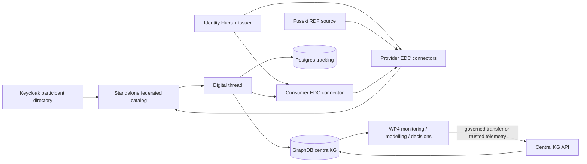
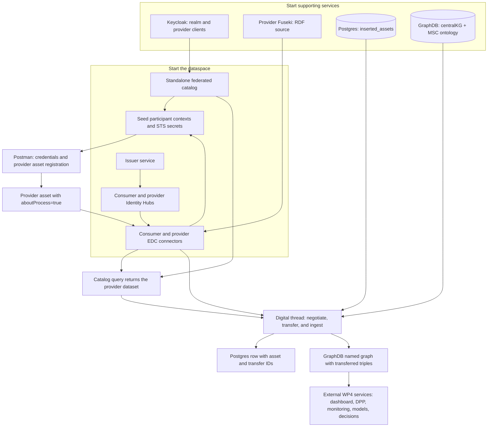

# End-to-End DMS Demo

This guide runs the local UniMaaS Data Management Suite (DMS): participant identity, RDF publication, EDC discovery and transfer, the federated catalog, digital-thread ingestion, Postgres tracking, and the central MSC knowledge graph.

It documents the repository's runnable services. The WP4 Dashboard, DPP application, monitoring platform/AAS/VO, modelling suite, and decision-making suite are integration partners, not services launched by this repository.

## Component Roles

| Component | Role in the demo | Runs here? |
| --- | --- | --- |
| Keycloak | Development participant directory. The federated catalog reads participant clients from its configured realm. | Yes, Docker |
| Issuer service | Issues/verifies the dataspace credentials used by participants. | Yes, Java |
| Consumer Identity Hub | Consumer DID, participant context, credentials, and identity services. | Yes, Java |
| Provider Identity Hubs | Separate identity services for the QnA and manufacturing providers. | Yes, Java |
| Consumer EDC connector | Consumer control plane: discovers/requests assets, negotiates agreements, and coordinates transfers. It also has a local cached catalog. | Yes, Java |
| Provider EDC connectors | Publish provider assets and enforce their access policies. QnA and manufacturing are separate connector configurations. | Yes, Java |
| IAM and data governance | Identity Hubs, issuer credentials, participant registration, and EDC access policies determine which participant can request each asset. | Partially: IAM/EDC services run here; policies must be configured per demo |
| Provider Fuseki | Local RDF/SPARQL source used by the provider-side assets. Both provider configurations can use this local source. | Yes, Docker |
| Standalone federated catalog | Discovers participant catalogs and provides the catalog API consumed by the digital thread. This is distinct from the consumer connector's cached catalog. | Yes, Java |
| Digital thread agent | Periodically selects matching catalog assets, retrieves them through EDC, records ingestion state, and writes RDF to the central KG. | Yes, Java |
| Postgres | Persistent tracking store for the digital thread's `inserted_assets` table. | Yes, Docker |
| GraphDB (`centralKG`) | Consumer-side MSC knowledge graph. It stores ingested RDF and applies the configured ontology/inference rules. | Yes, Docker |
| Central KG API | API for MSC/SPARQL queries and optional trusted WP4 telemetry ingestion. The digital-thread demo writes to GraphDB directly; this API is an optional additional service. | Yes, Python/Docker |
| Consumer Fuseki | Optional local triple store for independent query experiments. It is not the central KG target of the digital-thread flow. | Optional, Docker |
| Postman collection | Creates credentials/assets, runs transfer flows, and checks catalogs and service state. | Yes, local client |
| UniMaaS Dashboard | Captures user intent, coordinates service discovery/invocation, and presents recommendations and outcomes. | External to this repository |
| Digital Product Passport (DPP) service | Maintains product passport data linked to products/processes and exposes it under the agreed governance rules. DPP RDF can use the DMS, but the passport service is not implemented here. | External to this repository |
| Cloud-Based Monitoring Engine, AAS, and VO | Collects/normalizes resource and process telemetry and exposes virtual representations. The Central KG API has an optional trusted telemetry-ingestion endpoint, not the full monitoring engine/AAS/VO. | External except for the optional KG telemetry endpoint |
| WP4 Modelling Suite | Formal/use-case models and demand/asset prediction consume MSC and operational data and produce predictions or model outputs. | External to this repository |
| WP4 Decision-Making Suite | Planning/scheduling and optimization services apply objectives/constraints and return operational decisions. | External to this repository |
| Physical Smart Manufacturing Layer | Participants' MES, IIoT devices, sensors, actuators, robots, and shop-floor resources are data sources/decision targets behind participant adapters. | External to this repository |
| Real-Time Data and dataspace participants | Manufacturers/suppliers own source data; participant-side adapters map it to governed RDF/MSC assets and telemetry events. | External systems and participants |



The standard flow is: provider source -> provider EDC asset -> federated catalog -> consumer EDC negotiation/transfer -> digital-thread tracking in Postgres and RDF insertion into GraphDB. Keycloak participant registration does not replace EDC policy enforcement; EDC and the configured identity/credential services remain the data-access boundary.

## Workflow And Expected Results

The following is the run order and the evidence that each stage is working. A green process/container alone is not sufficient: verify its endpoint or the next-stage data it produces.



### Per-Component Success Signals

| Component | Observable expected output |
| --- | --- |
| Keycloak | `./keycloak/setup-demo.sh` ends with `Keycloak demo setup is ready: unimaas (2 provider clients)`. `GET /realms/unimaas/.well-known/openid-configuration` returns HTTP 200. |
| Issuer service | Its configured ports (`10010`-`10015`) are listening; Postman issuer participant/credential requests complete with a 2xx response. |
| Consumer Identity Hub | Its configured ports (`7080`-`7085`) are listening; the consumer DID resolves and credential requests complete. |
| Provider QnA Identity Hub | Its configured ports (`7090`-`7095`) are listening; provider QnA DID and credential requests succeed. |
| Provider manufacturing Identity Hub | Its configured ports (`7190`-`7195`) are listening; provider manufacturing DID and credential requests succeed. |
| Consumer EDC connector | Management API is available on port `8081`; catalog/negotiation/transfer requests using the local API key return a 2xx response. |
| Provider QnA EDC connector | Management API is available on port `8191`; Postman request `410-provider-connector` registers the file asset and returns HTTP 200. |
| Provider manufacturing EDC connector | Management API is available on port `8291`; provider-side asset requests succeed for the assets assigned to this participant. |
| IAM and data governance | The two provider clients exist in `unimaas`; seeded participant contexts/credentials succeed, and a consumer request is accepted only under its EDC policy/agreement. |
| Provider Fuseki | Authenticated query at `/provider/query` returns SPARQL results. The sample Turtle load reports a successful HTTP response; a basic graph query should find triples. |
| Consumer Fuseki (optional) | Authenticated query at `/consumer/query` responds. An empty store can return `ASK=false`; it is not part of digital-thread completion. |
| Standalone federated catalog | A `POST` QuerySpec to `/api/catalog/v1alpha/catalog/query` returns HTTP 200 and a JSON array containing registered provider catalog/dataset entries. |
| Postman collection | Provider asset requests `410` and `510` assert HTTP 200. Consumer requests `428` and `528` should return RDF for their respective file/Sparql flows. The `600` and `700` folders provide catalog and final checks. |
| Digital thread | Logs `PostgreSQL connection established successfully`, `Discovered N assets via FEDERATED mode` where `N > 0`, then `Ingestion in CentralKG Complete` for each asset that transfers successfully. |
| Postgres | `inserted_assets` exists. After a successful transfer, it contains a row with asset/provider IDs, transfer/negotiation/agreement IDs, properties, and creation time. |
| GraphDB (`centralKG`) | A named graph for the transferred asset contains one or more triples. Check the asset graph, not just the repository-wide count, because the initialized ontology already contributes triples. |
| Central KG API (optional) | Native API docs respond at `/docs`. Authenticated valid telemetry batches return HTTP 202; this endpoint is separate from EDC transfer. |
| UniMaaS Dashboard (external) | A user intent is submitted and the external orchestration displays a response/recommendation. This repo does not provide the dashboard or its success endpoint. |
| DPP service (external) | A product passport record is created/read by the external DPP service using the agreed product/MSC identifiers. This repo supplies no DPP application. |
| Cloud Monitoring Engine, AAS, and VO (external) | A measurement has an asset, metric, unit, timestamp, and source in the external monitoring/virtual-object stack. The optional KG API can acknowledge a trusted batch with HTTP 202. |
| WP4 Modelling Suite (external) | The external model returns a prediction/model output with its model version and input context. There is no model endpoint in this repo. |
| WP4 Decision-Making Suite (external) | The external planner/optimizer returns a schedule, allocation, or other decision with objective and constraint status. There is no optimizer endpoint in this repo. |
| Physical Smart Manufacturing Layer (external) | MES/IIoT/sensors expose real events or measurements to the participant adapter; actuations are not performed by this repo. |
| Real-time data and participants (external) | Provider-owned data is mapped to the configured participant and published as an EDC asset. Actual participant data is not included in this checkout. |

### Final DMS Checks

After the digital-thread log reports a successful ingestion, inspect the tracking rows:

```sh
docker exec central-platform-postgres \
  psql -U admin -d postgrescp \
  -c 'SELECT asset_id, provider_did, transfer_id, negotiation_id, agreement_id, created_at FROM inserted_assets ORDER BY created_at;'
```

The expected result is one new row per asset that passed the property filter and completed transfer. For a single qualifying smoke-test asset, expect at least one row. Do not expect a row for a catalog-only asset or one that failed policy negotiation/transfer.

To verify GraphDB, query named graphs and triple counts using the GraphDB endpoint and credentials configured for the local deployment:

```sh
set -a
. central-kg/graphdb/.env
set +a
curl -sS -u "$ADMIN_USER:$ADMIN_PASS" \
  -H 'Accept: application/sparql-results+json' \
  --get --data-urlencode 'query=SELECT ?graph (COUNT(*) AS ?triples) WHERE { GRAPH ?graph { ?s ?p ?o } } GROUP BY ?graph' \
  "$GRAPHDB_URL/repositories/$REPO_ID"
```

Expected: a SPARQL JSON result with a graph associated with the transferred asset and a positive triple count. The exact graph IRI and count vary with the asset ID and RDF payload.

Example success shape (illustrative; values vary by run):

```text
Keycloak demo setup is ready: unimaas (2 provider clients)
Discovered 1 assets via FEDERATED mode
Ingestion in CentralKG Complete
inserted_assets: 1 new row
centralKG: asset graph present, triples > 0
```

If Postgres has a row but no asset graph appears, inspect the digital-thread log for `Ingestion in CentralKG Complete` or an RDF parse/GraphDB error. If the catalog reports zero assets, check provider asset registration and the `aboutProcess=true` filter before investigating Postgres or GraphDB.

## Prerequisites

- Linux/macOS shell, Java 17, Docker Engine and Docker Compose.
- `curl`, `jq`, Git, and Postman (or an equivalent collection runner).
- Initialized repository submodules. On a fresh checkout, use `git submodule update --init --recursive`. If Git reports that a submodule path exists but is not empty, inspect it first; remove only directories confirmed to be empty.
- Authorized WP4 pilot RDF files if demonstrating partner data. The partner TTLs referenced below are not included in this checkout.

Build the Java services from the repository root:

```sh
./gradlew clean \
  :launchers:identity-hub:build \
  :launchers:runtime-embedded:build \
  :launchers:catalog-server:build \
  :launchers:issuerservice:build \
  :launchers:digital-thread:build \
  :launchers:standalone-federated-catalog:build
```

Use JDK 17 for this build. The launcher scripts run in the foreground and expect these JARs to exist.

## Run The Demo

Run each Java startup script in its own terminal from the repository root. Keep the terminals open to retain the services and see logs.

### 1. Start Keycloak

Run the Keycloak setup script from the repository root:

```sh
./keycloak/setup-demo.sh
```

The script creates the external Docker network if needed, starts Keycloak, waits for readiness, creates `unimaas` if absent, and creates or aligns the two provider clients (`did:web:localhost%3A7093:provider1` and `did:web:localhost%3A7193:provider2`). Existing unsuffixed demo clients are renamed in place. It prompts for the admin password only when it is not supplied in the environment or available from the existing container. It never prints client secrets. The Compose startup import file is `keycloak/realm-import/unimaas-realm.json`.

Verify the realm is available:

```sh
curl -fsS http://localhost:5080/realms/unimaas/.well-known/openid-configuration >/dev/null
```

The named Keycloak data volume is preserved. Existing admin credentials are not reset by changing environment variables; use the password from when that volume was initialized. If a realm or client already exists, the script is repeatable and does not create a duplicate. For the separate nested EDC node deployment, its OIDC client settings are in that deployment's own environment file and are not rewritten by this root demo script.

The DIDs and service endpoints in the `deployment/assets/env/` files are the source of truth for this local topology. If you change a DID, update the associated Identity Hub, connector, Keycloak client, seed data, and Postman variables together.

### 2. Start Provider Fuseki And Load Data

The repository includes a small provider sample suitable for checking local Fuseki and EDC wiring. It is not a substitute for the D9.1 pilot datasets.

```sh
mkdir -p fuseki/provider/databases
chmod 2775 fuseki/provider/databases
./fuseki/provider/start_provider_fuseki.sh
./fuseki/provider/load_data_provider.sh fuseki/provider/example_provider_data.ttl
```

The provider endpoint is `http://localhost:3032/provider/query`; the local Fuseki configuration requires authentication. The startup script checks that the host directory is writable and shares the host user's primary group with the container. If the directory is root-owned, inspect it before changing ownership; never remove it if it contains TDB data.

Consumer Fuseki is optional and is not used by the digital-thread ingestion path. To run it for a separate consumer-side RDF query experiment, use `./fuseki/consumer/start_consumer_fuseki.sh`; its endpoint is `http://localhost:3031`.

For the full Adient demonstration, obtain authorized files and place them at the paths expected by the demo requests:

- `demo/dataset_1/subgraph_pc1pc2_external.ttl` for external-process data.
- `demo/dataset_2/subgraph_pc3pc4_internal.ttl` for internal-process data.

Those two files are currently absent. The legacy demo prose also conflicts on which provider connector owns each dataset; follow the provider DID and endpoint configured in the Postman asset request rather than inferring ownership from the old prose.

### 3. Start GraphDB And Initialize `centralKG`

Use GraphDB's standalone Compose file; it does not need the central KG parent Compose include.

```sh
docker compose -f central-kg/graphdb/docker-compose.yml up -d
```

The repository initializer reads `central-kg/graphdb/.env`. Create this local, uncommitted file if it is missing, and set `GRAPHDB_URL`, `REPO_ID`, `ADMIN_USER`, and `ADMIN_PASS` to match the GraphDB container configuration. Do not commit passwords. Initialize the repository from its directory:

```sh
cd central-kg/graphdb
./scripts/init-repo.sh
cd ../..
```

This creates repository `centralKG` with the MSC ontology and configured inference rules. GraphDB is available at `http://localhost:7200`; initialization must complete before the digital thread starts.

### 4. Start Postgres And Create The Tracking Table

The native digital-thread configuration in `deployment/assets/env/digital_thread.env` expects `localhost:5432/postgrescp`, user `admin`, and table `inserted_assets`. The `central-kg/docker-compose.yaml` currently includes an EDC Compose file at a path that is absent in this checkout, so its `PC01`/central parent Compose route may fail before starting Postgres. The following standalone container matches the native digital-thread configuration and avoids changing that submodule:

```sh
export DMS_POSTGRES_PASSWORD='choose-a-local-development-password'
docker volume create dms-digital-thread-postgres
docker run -d \
  --name central-platform-postgres \
  -e POSTGRES_USER=admin \
  -e POSTGRES_PASSWORD="$DMS_POSTGRES_PASSWORD" \
  -e POSTGRES_DB=postgrescp \
  -p 127.0.0.1:5432:5432 \
  -v dms-digital-thread-postgres:/var/lib/postgresql \
  postgres:18
```

Set `POSTGRES_PASSWORD` in `deployment/assets/env/digital_thread.env` to the same local value. For subsequent runs, use `docker start central-platform-postgres` instead of creating another container. Create the tracking table:

```sh
docker exec -i central-platform-postgres \
  psql -v ON_ERROR_STOP=1 -U admin -d postgrescp \
  < launchers/digital-thread/postgres/table_creation.sql
docker exec central-platform-postgres pg_isready -U admin -d postgrescp
```

The separate helper `launchers/digital-thread/postgres/start_postgres.sh` uses a different legacy endpoint (`5433/mydb`). Do not use that helper with the current `digital_thread.env` unless you intentionally change the database configuration to match.

### 5. Start Issuer, Identity Hubs, Connectors, And Catalog

Start these services in the listed order, each in a separate terminal. Keycloak, GraphDB, Fuseki, and Postgres should already be running.

| Order | Command | Component |
| --- | --- | --- |
| 1 | `./scripts/startups/start-issuer-service.sh` | Credential issuer |
| 2 | `./scripts/startups/start-identityhub-consumer.sh` | Consumer Identity Hub |
| 3 | `./scripts/startups/start-identityhub-provider-qna.sh` | Provider QnA Identity Hub |
| 4 | `./scripts/startups/start-identityhub-provider-ms.sh` | Provider manufacturing Identity Hub |
| 5 | `./scripts/startups/start-connector-consumer.sh` | Consumer connector |
| 6 | `./scripts/startups/start-connector-provider-qna.sh` | Provider QnA connector |
| 7 | `./scripts/startups/start-connector-provider-manufacturing.sh` | Provider manufacturing connector |
| 8 | `./scripts/startups/start-standalone-catalog.sh` | Federated catalog |

The corresponding VS Code tasks are `ST10`, `ST20`-`ST22`, `ST30`-`ST32`, and `ST41`. `ST99` starts only the Java processes and does so in parallel; it does not start the Docker dependencies or enforce the order above. `ST98` is stale in the current task file: it references undefined `GD*` labels. Use individual tasks or commands.

### 6. Seed Local Participant State

After the Identity Hubs, connectors, and catalog are ready, run:

```sh
./scripts/seed.sh
```

The script creates local participant contexts and stores generated STS client secrets in connector/catalog secret stores. It requires `curl` and `jq`, and its debug output can contain generated secret material. Do not capture or share that output; do not use this demo seed process in production.

### Recover An Interrupted Demo

Local Java runtimes use in-memory identity and secret stores unless explicitly built/configured for persistence. Restarting an issuer can lose its signing key; restarting a connector or catalog can lose its STS secret. Do not blindly rerun `seed.sh` against existing contexts.

After all Java services and Docker dependencies are running, the following explicit recovery sequence replaces only the three demo participant contexts, updates connector/catalog STS secrets, and reissues their membership credentials. It preserves Postgres, GraphDB, and Fuseki data. Run it only when replacing the previous demo identities is intended:

```sh
bash scripts/complete-demo-setup.sh --configure-directory
bash scripts/complete-demo-setup.sh --reset-identities
bash scripts/complete-demo-setup.sh --issue-credentials
```

Wait until the Identity Hub credential API shows the new credentials in issued state (`500`), then remove stale credentials and publish the smoke assets:

```sh
bash scripts/complete-demo-setup.sh --prune-credentials
bash scripts/complete-demo-setup.sh --register-assets
```

The setup script reads existing local credentials without printing generated secrets. It checks HTTP results and stops on errors. The registered assets are `dms-smoke-file` on QnA (the checked-in provider Turtle file) and `dms-smoke-sparql` on manufacturing (the provider Fuseki `CONSTRUCT` result). Both require membership and carry `aboutProcess=true`. These are local smoke assets, not pilot datasets. The standalone catalog resolves suffixed DIDs at `/provider1/did.json` and `/provider2/did.json`.

Participant public keys use the same checked-in development key files as `seed.sh`, matching the keys seeded into the in-memory runtimes. These development keys are not suitable for production. If replacing signing identities in already-running services leaves stale key/token caches, stop and restart the demo Java services together before running recovery; do not stop or delete the Docker data stores.

After any later connector/catalog restart, its STS secret must be restored again. The `--reset-consumer` stage repairs the consumer and standalone catalog together, but also requires credential reissuance and stale-credential pruning afterward. Do not reset contexts while transfers are in progress.

Start only one digital-thread process after the catalog contains both smoke assets. After ingestion, run:

```sh
bash scripts/complete-demo-setup.sh --verify
```

This checks the two catalog entries, tracking IDs, and positive triple counts in both asset graphs. The local smoke run verified on 2026-10-21 produced two tracking rows and 40 triples in each smoke graph. Both negotiations reached `FINALIZED`; HTTP pull transfers remained `STARTED` while their EDRs were active. Later cycles skipped the already tracked assets without adding rows.

### 7. Register Assets And Exercise EDC Transfers

Import `deployment/postman/EDC-Request-RDF-Service-local.postman_collection.json` into Postman and configure local variables for the consumer, provider, issuer, and management endpoints. Use the values from the local config files, not credentials copied from documentation.

Run the collection in its displayed order, adapting only environment-specific values:

1. `000 Seed Standalone Federated Catalog` and `000-Issuer-Credential Service` for the local catalog/credential setup.
2. `100-Make-IDHub-VerifiableCredential` for participant credential operations.
3. `400-Request-RDF-Service-Flow (File Asset)`: run the provider asset request (`410-provider-connector`) and then the consumer request (`412-consumer-connector`).
4. `500-Request-RDF-Service-Flow (Sparql Endpoint Asset)`: run the provider asset request (`510-provider-connector`) and then the consumer request (`512-consumer-connector`).
5. `600-Standalone-Federated-Catalog-Server` to query the catalog.
6. `700-Check` for the collection's final checks.

Confirm the provider requests return success and the catalog contains the expected assets before starting the digital thread. Its current property filter is `http://www.w3.org/ns/msc_dms#aboutProcess=true` from `deployment/config/demo_dms.json`; assets must carry the matching property to be selected. The collection's file-asset example uses `example_provider_data.ttl`. For actual WP4 pilot runs, use the authorized pilot RDF assets and the matching provider setup.

### 8. Start The Digital Thread

After catalog discovery, Postgres, and GraphDB are confirmed healthy, start the agent in its own terminal:

```sh
./scripts/startups/start-digital-thread.sh
```

The agent polls on the configured interval (60 seconds by default). Successful startup should show `PostgreSQL connection established successfully`; successful catalog access should show the discovered asset count. For each matching asset, the agent retrieves RDF through EDC, records it in `inserted_assets`, and inserts the RDF into GraphDB.

Check tracking rows:

```sh
docker exec central-platform-postgres \
  psql -U admin -d postgrescp \
  -c 'SELECT asset_id, provider_did, created_at FROM inserted_assets ORDER BY created_at;'
```

Check GraphDB at `http://localhost:7200` using the repository credentials. Query for triples in `centralKG`; for MSC step inference, use the `sc:hasNextStep` query in [GraphDB documentation](../central-kg/graphdb/README.md).

An empty `Discovered 0 assets` result is not a database failure: verify that provider connectors are running, participant clients are registered, provider assets exist, and asset properties match the digital-thread filter. An empty `inserted_assets` table is expected until at least one qualifying asset transfers successfully.

## Optional WP4 Infraflex Telemetry

The Central KG API is not required for the standard EDC/digital-thread flow. It is the additional API boundary for trusted WP4 queries and Infraflex telemetry. Follow [the API setup](../central-kg/centralKG_API/README.md), configure a private telemetry API key and GraphDB update endpoint in `central-kg/centralKG_API/api.env`, then start the API. Native mode serves port `8000`; the Compose mapping described in the central KG repository exposes port `80`.

`POST /telemetry/events` accepts 1-500 timestamped numeric measurements and requires the `X-API-Key` header. Load `central-kg/graphdb/config/infraflex-telemetry.ttl` into `centralKG` before querying observations. Use EDC to transfer governed monitoring datasets; this API is for a trusted consumer-side adapter, not a replacement for EDC or an unauthenticated public endpoint.

The WP4 Dashboard, DPP, cloud monitoring/AAS/VO, modelling suite, and decision-making suite are not launched by this guide. Integrate them using the contracts and pilot mapping in the root [README](../README.md#integrating-with-wp4).

To run the Central KG API for WP4 query/telemetry integration, configure `central-kg/centralKG_API/api.env` and follow its [API setup guide](../central-kg/centralKG_API/README.md). In native mode, run `scripts/start-api.sh` from `central-kg/centralKG_API`; the service listens on port `8000`. This API is optional for the standard Postman/digital-thread demo.

## Local Endpoints

| Service | Endpoint |
| --- | --- |
| Keycloak | `http://localhost:5080` |
| Provider Fuseki | `http://localhost:3032/provider/query` |
| GraphDB | `http://localhost:7200`, repository `centralKG` |
| Postgres | `localhost:5432/postgrescp` |
| Consumer connector management API | `http://localhost:8081/api/management` |
| Provider QnA connector management API | `http://localhost:8191/api/management` |
| Provider manufacturing connector management API | `http://localhost:8291/api/management` |
| Standalone federated catalog | `http://localhost:8184/api/catalog` |
| Central KG API (optional) | `http://localhost:8000` |

For the complete Identity Hub, connector, and issuer port ranges, see [developer documentation](./developer.md).

## Stop The Demo

Stop each Java process with Ctrl+C in its terminal. Stop only the containers started for this demo:

```sh
docker stop central-platform-postgres graphdb keycloak fuseki-server-provider
```

The Postgres named volume and GraphDB/Fuseki data directories persist after stopping. Do not remove volumes or delete database directories unless intentionally resetting the demo data.

## Known Repository Limits

- `central-kg/docker-compose.yaml` includes an EDC Compose file at a relative path that is not present in this checkout. Use the standalone GraphDB Compose file and the Postgres command above unless that include has been repaired for your workspace.
- The `PC01` and `GC01` VS Code tasks invoke the central KG parent Compose file and may hit that include issue. `ST98` also references undefined `GD*` tasks.
- The D9.1 Adient TTL files are not checked in. The checked-in `example_provider_data.ttl` supports a local smoke demonstration only.
- Keycloak, GraphDB, Postgres, connector, and seed configurations contain development-oriented settings. Replace local credentials, restrict service ports, and never publish generated secrets or pilot data.